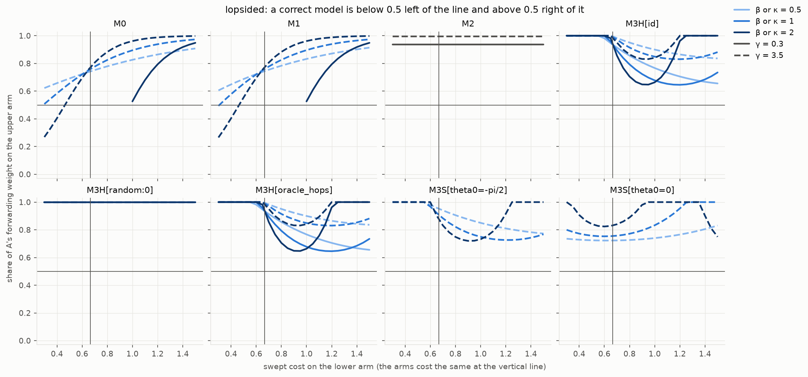

# PhaseFlow

**Archived, 2026-10-03, with a negative result.**

PhaseFlow asked whether a locally propagated complex-valued field, whose
phase encodes link cost, can act as a routing primitive on an ordinary
classical network: nodes hold a small complex state per destination,
exchange it only with neighbours, and route alternatives reinforce or
cancel. The question was whether that interference carries routing
information that a matched real-valued local field does not.

It does not, on the graphs tested. Read **[the technical report](docs/phaseflow_tech_report.md)**
first; it is the record.

## The result in brief

Two formulations were tested as separate hypotheses, against a
one-real-per-node attenuation field (M0), a matched two-real control (M1)
and the same complex field with phase disabled (M2).

- **M3-H, Hermitian (chiral) field.** Provably blind to the sign of the loop
  flux on bipartite graphs, so it splits the standard diamond exactly 50/50
  whatever the costs. On odd cycles it steers forwarding by a chirality that
  is set by the edge orientation and by `2π` wrap-around, not by which route
  is cheaper: moving the dear edge to its mirror image reverses which cells
  are right. At damping `γ ≥ 1` phase changes no forwarding decision at all.
- **M3-S, complex-symmetric field.** Responds to cost on equal-hop arms, but
  the sign of the response flips when `β` doubles or the per-hop phase
  changes. It never prefers a cheaper arm that has more hops, and it is
  stable in only 340 of 750 cells.
- **The real control M0** has five parameter cells that forward correctly on
  every cyclic scenario; no M3-H or M3-S cell does. Where cost-derived phase
  changes a decision it makes it worse more often than better (167 against
  15 for M3-H, 63 against 30 for M3-S).

Two findings went the other way and are recorded: under proportional
forwarding the Hermitian current wastes less than M0 (a property shared by
the cost-blind M2, so not a phase effect), and one M3-S rule is cost-correct
on equal-hop arms in every test while failing wherever hop counts differ.



*A correct model is below 0.5 left of the vertical line and above it on the
right. Only the real controls cross.*

## Documents

| Document | What it is |
|---|---|
| [`docs/phaseflow_tech_report.md`](docs/phaseflow_tech_report.md) | The archival record: question, models, the two pre-run theorems, results, mechanism, prior work, limitations, decision. |
| [`docs/experiment-0.md`](docs/experiment-0.md) | The full findings of Experiment 0, with every number tied to a results file, and the changes made after an independent review. |
| [`docs/literature.md`](docs/literature.md) | Prior-art note with retrieved URLs. |
| [`docs/phaseflow_kickoff.md`](docs/phaseflow_kickoff.md), [`docs/phaseflow_research_charter.md`](docs/phaseflow_research_charter.md) | The original question and the working rules. |
| [`docs/superpowers/specs/`](docs/superpowers/specs/), [`docs/superpowers/plans/`](docs/superpowers/plans/) | The experiment design and the implementation plan it was built from. |

## Reproducing the experiment

Requires Python 3.12 or later and [`uv`](https://docs.astral.sh/uv/).

```bash
uv sync
uv run pytest -q                           # 72 tests, including the convention and symmetry checks
uv run python -m phaseflow.experiment0     # the predeclared sweep, about 8 seconds
uv run python -m phaseflow.analysis        # post-hoc tables, written to posthoc.json
```

Outputs go to `results/experiment0-smoke/`. The run is deterministic;
`config.json` records the grid, seeds, package versions and the code
commit. Three large CSVs (`states.csv`, `currents.csv`,
`static_readouts.csv`) are not committed and are recreated by the first
command.

## Layout

```text
src/phaseflow/
  graph.py, topology.py     undirected weighted graphs; path, tree, diamond, lopsided diamond, ring
  models.py                 the five coupling rules, orientation conventions, loop flux
  engine.py                 local synchronous iteration with a node-local step rule
  oracle.py                 exact fixed point and spectra, used for validation only
  readout.py                power-inflow readout, forwarding weights, cancellation
  metrics.py                shortest-path reference, routes, stretch, loops, stochastic policy
  perturbations.py          cost-change schedule
  scenarios.py              scenarios and the predeclared grid
  experiment0.py            static sweep, dynamic run, writers, command-line entry point
  analysis.py               post-hoc analyses (defined after the run, labelled as such)
  plots.py                  figures drawn from the written CSVs
tests/                      one module per source module
results/experiment0-smoke/  data, summary, post-hoc tables, plots
docs/                       report, findings, literature, kickoff, charter, spec, plan
```

## Status

Closed. The project is kept so that the negative result can be checked and
reproduced. The one open thread noted in the report is that a single
forwarding readout was tested; a phase-reading alternative would be a
different hypothesis.

## License

[MIT](LICENSE).
